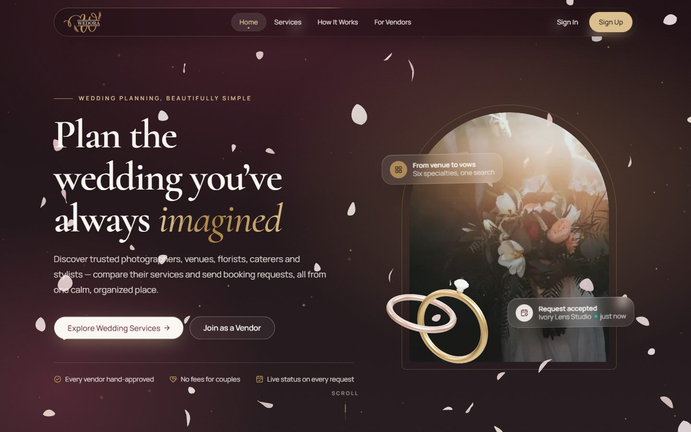
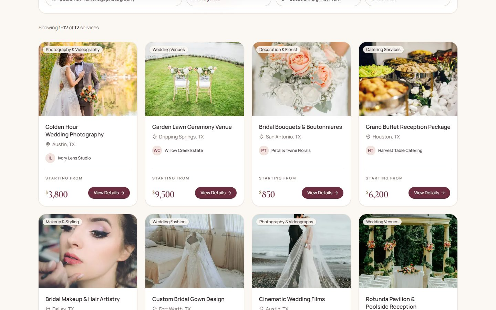
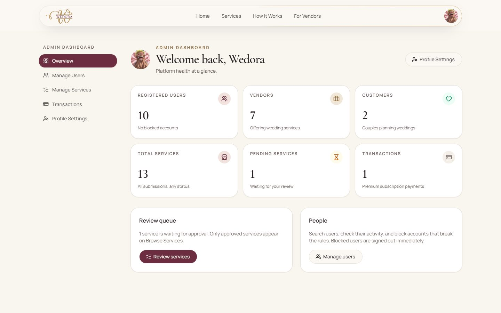
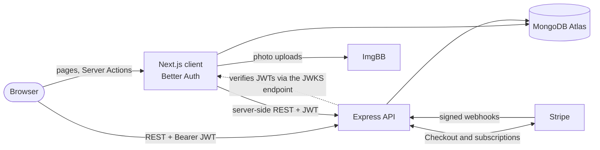

<div align="center">

<picture>
  <source media="(prefers-color-scheme: dark)" srcset="src/assets/brand/logo-white.png">
  
</picture>

### Wedding planning, beautifully simple.

A wedding services marketplace. Couples discover trusted vendors and request bookings, vendors grow their business, and admins keep every listing trustworthy.

**[Live site](https://wedora-planner.vercel.app)** · **[REST API](https://wedora-planner-server.vercel.app/api/health)** · **[Server repository](https://github.com/shariardipto/Wedora-Server)**


</div>



## Contents

- [Overview](#overview)
- [Live demo](#live-demo)
- [Features](#features)
- [Screenshots](#screenshots)
- [Tech stack](#tech-stack)
- [Architecture](#architecture)
- [Project structure](#project-structure)
- [Getting started](#getting-started)
- [Environment variables](#environment-variables)
- [Scripts](#scripts)
- [Quality](#quality)
- [Deployment](#deployment)
- [Copyright](#copyright)

## Overview

This repository is the **web client** of Wedora, built with the Next.js 16 App Router. It renders every page, owns authentication through [Better Auth](https://better-auth.com), uploads images, and issues short-lived JWTs. The **[Wedora API](https://github.com/shariardipto/Wedora-Server)** (Express 5) handles all business data and verifies those JWTs.

Wedora has three roles:

| Role | What they do |
| --- | --- |
| **Customer** (couple) | Browse and compare services, request a booking for an event date, and track every reply |
| **Vendor** | Publish services for review, accept or reject booking requests, and upgrade to Premium |
| **Admin** | Approve or reject listings, manage and block users, and audit payments |

Services are grouped into six categories: Photography & Videography, Wedding Venues, Decoration & Florist, Catering Services, Makeup & Styling, and Wedding Fashion.

## Live demo

| | |
| --- | --- |
| Website | <https://wedora-planner.vercel.app> |
| REST API | <https://wedora-planner-server.vercel.app> |
| Server repository | <https://github.com/shariardipto/Wedora-Server> |

- **Try it:** sign up as a *Customer* to request bookings, or as a *Vendor* to publish services. Google sign-in is supported.
- **Test payments:** Stripe runs in test mode. Use card `4242 4242 4242 4242` with any future expiry date and any CVC.
- **Admin access:** admin accounts can't be created through sign-up. Reviewer credentials are provided with the submission.

## Features

### For couples
- **Browse Services:** search by name, filter by category and location, sort by price, and page through results. Filters live in the URL, so results survive a reload or a shared link.
- **Service details:** a photo gallery, pricing, location, description and vendor information.
- **Booking requests:** pick an event date, location and message. Duplicate requests for the same date are refused.
- **My Bookings:** status tabs with counts, full request details, and cancellation while a request is still pending.
- **Dashboard overview:** booking statistics and recent requests.

### For vendors
- **My Services:** create, edit, pause, resume and delete listings, each with 1–5 photos.
  - New and edited listings go to admin review.
  - Rejected listings show the admin's reason.
- **Booking Requests:** customer contact details and message; accept or reject each request once.
- **Plans:**
  - **Free:** up to 3 active services.
  - **Premium:** unlimited services and a Premium vendor badge for $29/month through Stripe Checkout, with cancel and resume and a full payment history.
- **Dashboard overview:** service, booking and plan statistics.

### For admins
- **Overview:** users, vendors, customers, services, pending reviews and transactions at a glance.
- **Manage Services:** search and filter, approve, reject with a reason, send back to review, or delete.
- **Manage Users:** search, filter by role and status, view activity, and block or unblock. Blocking signs the user out immediately, and admin accounts are protected.
- **Transactions:** a read-only Stripe payment ledger with search, status filters and revenue totals.

### Platform
- **Authentication:**
  - Sign-in methods: email and password (with password rules) or Google. Google users choose their account type once.
  - **Route protection:** pages are guarded on the server by role, and users who type another role's URL are sent back to their own dashboard.
  - **Return URLs:** safe from open redirects.
- **Trust by design:**
  - Users can never set their own role, block status or plan.
  - Premium is activated only by the API's verified Stripe webhook, never by the browser.
- **Profile Settings:**
  - Name, phone, business name (vendors) and a profile photo. Sign-up stays short: the photo is added here after signing in.
  - Photos can be dragged in. They're cropped and shrunk to a 512 px WebP in the browser before upload; in testing, a 9 MB photo became 37 KB.
- **"Golden Hour" interface:**
  - **An animated logo that writes itself** (SVG and GSAP): it loops in the navbar, footer and sign-in panel, and opens the home page as a full-page intro.
  - A WebGL hero (Three.js with React Three Fiber) and GSAP text reveals. Cards rise in one by one as they scroll into view.
  - A closing footer scene: the WEDORA wordmark writes itself while a gold light drifts through the letters and follows the cursor.
  - Lenis smooth scrolling, tilt cards, and a floating glass navbar.
- **Responsive and accessible:**
  - Mobile-first layouts with no horizontal scrolling. On phones the dashboards switch to a one-row tab bar, and admin tables become card lists.
  - Keyboard and screen-reader friendly.
  - Every animation respects *reduced motion*.
- **Fast:**
  - Server-rendered pages stream with React Suspense (no layout shift).
  - The 3D scene loads only on devices with a real GPU, and both apps run in the same region as the database.
- **Feedback everywhere:** toasts for every action, plus loading, empty and error states.

## Screenshots

| Browse Services | Admin dashboard |
| --- | --- |
|  |  |

## Tech stack

| Area | Technology |
| --- | --- |
| Framework | Next.js 16 (App Router, Turbopack), React 19 |
| Language | TypeScript (strict) |
| Authentication | Better Auth: MongoDB adapter, Google OAuth, JWT plugin (EdDSA) |
| Data | Wedora REST API; MongoDB Atlas for auth data |
| Forms and validation | React Hook Form, Zod |
| Styling | Tailwind CSS 4, shadcn/ui (Radix primitives) |
| Motion and 3D | GSAP (ScrollTrigger, SplitText), Lenis, Motion, Three.js, React Three Fiber |
| Images | ImgBB, uploaded server-side from a Server Action |
| Payments | Stripe Checkout (through the API) |
| UI feedback | Sonner toasts, lucide-react icons |
| Testing and linting | Vitest, ESLint (zero-warning policy) |
| Hosting | Vercel (`sin1` region) |

## Architecture



- **Identity:** Better Auth signs users in and stores sessions in MongoDB. For API calls, the client issues a 15-minute EdDSA JWT. The API verifies it against the client's public JWKS endpoint (`/api/auth/jwks`).
- **Authority:** the token only proves *who* the caller is. The API reads the user's role, block status and plan from the database on every request.
- **Guards in layers:**
  - `src/proxy.ts` does a fast cookie-based redirect.
  - Each dashboard layout checks the session and role on the server.
  - The API enforces everything again.
- **Uploads:** the ImgBB key never reaches the browser. A Server Action re-checks the session, then validates the file's type, size and magic bytes before uploading it.

## Project structure

```text
src/
├── app/
│   ├── (site)/          # Public pages: home, services, sign-in/up, onboarding, payment, blocked
│   ├── dashboard/       # Customer, vendor and admin dashboards, plus Profile Settings
│   └── api/auth/        # Better Auth route handler (sessions, OAuth, JWKS, tokens)
├── actions/             # Server Actions (authenticated image upload)
├── components/          # UI by feature: admin, auth, billing, bookings, dashboard, home,
│                        # layout, motion, services, vendor, and ui (shadcn/ui primitives)
├── lib/                 # API clients, Better Auth config, validation, formatting, image shrinking
├── hooks/  config/  assets/
└── proxy.ts             # Optimistic route guard (Next.js 16 replacement for middleware)
scripts/                 # seed-admin.ts, seed-demo.ts
docs/screenshots/        # Images used in this README
```

## Getting started

### Prerequisites

- Node.js **24** and npm
- A MongoDB Atlas cluster (MongoDB 6.0 or newer), shared with the API
- The [Wedora API](https://github.com/shariardipto/Wedora-Server) running locally (default `http://localhost:5000`)
- An [ImgBB](https://api.imgbb.com) API key
- Optional: a Google OAuth client for Google sign-in

### Setup

```bash
git clone https://github.com/shariardipto/Wedora-Client.git
cd Wedora-Client
npm ci
cp .env.example .env.local    # fill in the values (see below)
```

> If your shell sets `NODE_ENV=production`, install with `npm ci --include=dev` so the dev tools are included.

1. In the **server** repository, run `npm run db:setup` once to create the database indexes, then start it with `npm run dev`.
2. Create the admin account: `npm run seed:admin`. It reads `ADMIN_*` from `.env.local`.
3. Optional: add demo content with `npm run seed:demo`:
   - 6 vendors with approved services in every category
   - services waiting for review
   - a demo customer with bookings

   Remove it later with `npm run seed:demo -- --reset`.
4. Start the app with `npm run dev`, then open <http://localhost:3000>.

For Google sign-in during local development, add `http://localhost:3000` as an authorised JavaScript origin. Add `http://localhost:3000/api/auth/callback/google` as a redirect URI.

## Environment variables

Copy [`.env.example`](.env.example) to `.env.local`. Only variables prefixed with `NEXT_PUBLIC_` reach the browser. They are inlined at build time, so redeploy after changing them, and never put secrets in them.

| Variable | Required | Description |
| --- | :---: | --- |
| `NEXT_PUBLIC_APP_URL` | ✓ | Public URL of this app, e.g. `http://localhost:3000` |
| `NEXT_PUBLIC_API_URL` | ✓ | Base URL of the Wedora API, e.g. `http://localhost:5000` |
| `BETTER_AUTH_SECRET` | ✓ | 32+ character secret (`npx @better-auth/cli secret`). It also encrypts the JWT signing keys stored in the database, so every deployment that shares the database must use the same value |
| `BETTER_AUTH_URL` | ✓ | This app's origin; it's also the JWT issuer and audience |
| `MONGODB_URI` | ✓ | MongoDB connection string (the same cluster as the API) |
| `MONGODB_DB_NAME` | | Database name (default `wedora`) |
| `GOOGLE_CLIENT_ID`, `GOOGLE_CLIENT_SECRET` | | Google OAuth credentials |
| `IMGBB_API_KEY` | ✓ | ImgBB key for profile and service photos (server-side only) |
| `ADMIN_NAME`, `ADMIN_EMAIL`, `ADMIN_PASSWORD` | | Used only by `npm run seed:admin` |
| `DEMO_PASSWORD` | | Optional password for accounts created by `npm run seed:demo` |

## Scripts

| Command | Description |
| --- | --- |
| `npm run dev` | Start the development server on port 3000 |
| `npm run build` | Create a production build |
| `npm start` | Serve the production build |
| `npm run lint` | Run ESLint (fails on any warning) |
| `npm run typecheck` | Generate route types and type-check the project |
| `npm test` | Run the unit tests (Vitest) |
| `npm run seed:admin` | Create or repair the admin account from the `ADMIN_*` values |
| `npm run seed:demo` | Add demo vendors, services and bookings (idempotent; `-- --reset` removes them) |

## Quality

- **Static checks:** strict TypeScript and ESLint with a zero-warning policy.
- **Unit tests:** 71 Vitest tests. They cover sign-up and profile validation, safe redirect handling, service and admin query parsing, booking validation, billing helpers, date and money formatting, image upload checks, the in-browser image shrinking, and the animated logo's timeline.
- **Lighthouse on the live site** (desktop, November 2026):
  - Performance: Home 98, Browse Services 94, Sign In 97.
  - Layout shift (CLS): 0.

## Deployment

The app is deployed on **Vercel**.

1. Import the repository; Next.js is detected automatically. [`vercel.json`](vercel.json) pins functions to `sin1` (Singapore), next to the MongoDB Atlas cluster.
2. Add every variable above in **Project → Settings → Environment Variables**:
   - `NEXT_PUBLIC_APP_URL` and `BETTER_AUTH_URL`: the production URL.
   - `NEXT_PUBLIC_API_URL`: the API URL.
3. **Google OAuth:**
   - Authorised origin: `https://<your-domain>`
   - Redirect URI: `https://<your-domain>/api/auth/callback/google`
4. On the **API** deployment:
   - `CLIENT_ORIGIN`, `BETTER_AUTH_ISSUER` and `BETTER_AUTH_AUDIENCE`: this app's URL.
   - `BETTER_AUTH_JWKS_URL`: `https://<your-domain>/api/auth/jwks`

## Copyright

© 2026 Wedora. All rights reserved.

Designed and developed by [The Code Work Studio](https://thecodeworkstudio.com).
